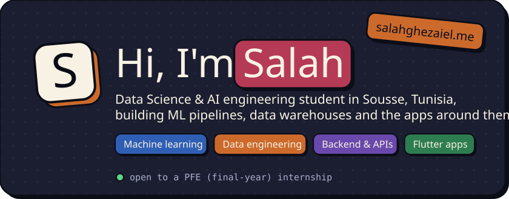
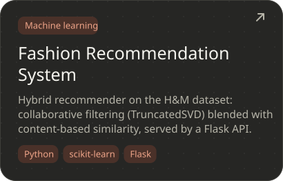
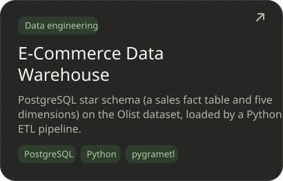
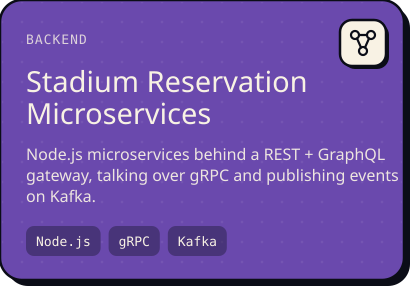
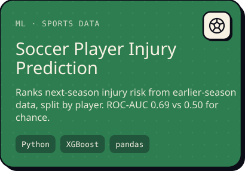
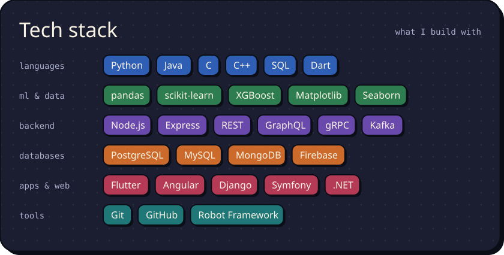

  

  &nbsp;
  &nbsp;
  &nbsp;
  

 

  
  

  
  

 

  

Cards drawn by <a href="scripts/build_cards.py">scripts/build_cards.py</a> · more on <a href="https://salahghezaiel.me">salahghezaiel.me</a>

